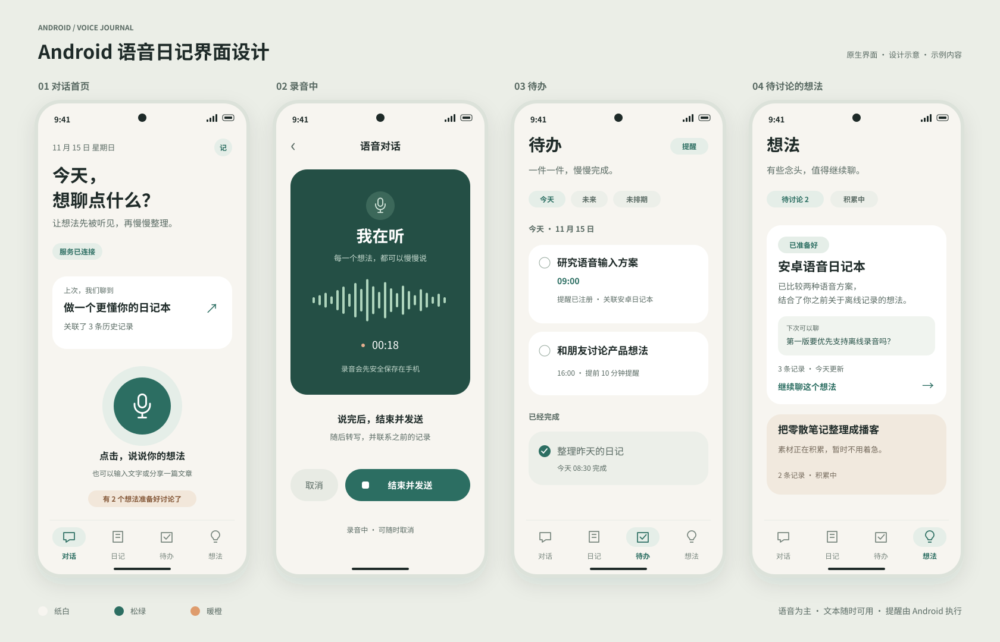

# Android 语音日记应用开发方案

状态：第一版在 ReMe3 实现，部署与测试命令见 [客户端说明](../../reme_android/README.md)。设计日期：2026 年 11 月 15 日。

应用以语音对话为主要入口，让用户随时记录想法，结合历史形成日记，并持续维护待办和 ideas。
Python 后端部署在用户自己的服务器，Android 使用原生界面，连接时填写服务地址、端口和 Token。

## 已确定的范围

| 项目 | 开发要求 |
| --- | --- |
| 后端 | 基于 ReMe，在 ReMe3 开发并部署到用户自有服务器，运行 Python、Codex、ASR、TTS 和整理任务 |
| 后端改动边界 | 复用现有组件，HTTP 增加鉴权和必要的入口隔离；新增业务集中在 `reme/steps/android_app/`，配套应用配置和注册导入 |
| 客户端 | Kotlin 和 Jetpack Compose 原生开发，负责界面、录音、播放、本地数据、同步和系统提醒 |
| 连接 | 支持 HTTP 和 HTTPS，通过地址、端口及 Token 访问；移动网络来源 IP 可以变化 |
| 鉴权 | 服务端校验 `Authorization: Bearer <token>`；第一版采用一个工作区、一个访问 Token |
| 核心界面 | 语音对话首页，配套日记、待办和想法页面；支持文字输入和系统分享 |
| 持久数据 | 服务端工作区文件为已提交内容的权威来源；手机保留本地视图、离线输入和待同步操作 |
| 最终文档 | 始终维护 `TODO.md` 和 `IDEAS.md`，每个任务和 idea 有独立 Markdown 文件 |
| 后台能力 | 服务端整理记录和预研 ideas；Android 根据已同步计划执行到点提醒 |

第一版交付完整的逐轮语音对话：录音、转写、理解、回复、朗读，以及再次录音和打断播放。
ASR 使用现有整段识别能力。实时字幕、全双工通话和唤醒词作为后续扩展，不在第一版展示虚假的实时状态。
第一版不包含 APK 内嵌 Python、多租户账号系统、社交、自动执行外部事务和复杂重复任务。

## 系统架构

```text
Android 原生 App
  ├─ Compose 界面与语音交互
  ├─ 录音、播放、通知和 AlarmManager
  └─ Room、本地音频、待上传输入与待同步操作
                 │
           HTTP 或 HTTPS + Bearer Token
                 │
服务器           ▼
  可选 HTTPS 网关 → ReMe HttpService 与 App Token 鉴权
                        ├─ android_app Steps
                        ├─ 现有文件操作与用户工作区
                        ├─ AgentRuntime 与后台任务
                        ├─ Codex 原生工具和网页工具
                        └─ ASR 与 TTS 组件

Codex 的 ScopedMCP 使用独立的本机监听与会话级 Token。
```

Android 主动建立请求；手机无需开放端口。前台使用 SSE 观察处理进展，后台通过 WorkManager 同步。
服务端可以在手机离线期间继续预研。没有推送通道时，研究成果在下一次同步后出现在 App 中；
不能依赖后台 SSE 保证即时通知。第一版到点提醒以 Android 本地计划为基础，预研推送单独扩展。

阿里云的 SSH 端口继续保留管理 IP 白名单。App 的 HTTP 或 HTTPS 端口按独立规则开放，
所有业务请求经过 Token 校验。服务器提供 HTTPS 网关时，Python 监听 `127.0.0.1:2333`；
直接提供 HTTP 时，由用户明确配置监听地址、端口和防火墙范围。

## 当前代码与复用边界

| 当前入口 | 可复用内容 | 本应用新增内容 |
| --- | --- | --- |
| [HttpService](../../reme/components/service/http_service.py) | Job 的 JSON 和 SSE 服务 | 可选 Token 鉴权、媒体大小限制、内部工具入口隔离 |
| [BaseService](../../reme/components/service/base_service.py) | 服务 Job 白名单和生命周期 | Android 专用公开 Job 集合 |
| [语音 Steps](../../reme/steps/common/speech.py) | Base64 音频协议、整段 ASR 和 TTS | 语音输入保存、运行状态、播放与重试 |
| [BaseTTS](../../reme/components/tts/base_tts.py) | 音频收集与完整结束标记 | 客户端自动朗读和打断 |
| [AgentRuntime](../../reme/components/agent_runtime/base_agent_runtime.py) | 会话、事件、后台执行及锁 | 日记整理和预研的产物校验 |
| [ProactiveAgentStep](../../reme/steps/proactive/agent/proactive.py) | 历史关联、在线策略、Markdown 产出模式 | 面向任务、ideas 和日记的独立工作流 |
| [BaseConnectorStep](../../reme/steps/proactive/data_connectors/base_connector.py) | 完整资源包发布方式 | 手机输入及录音资源包 |
| [文件操作](../../reme/steps/file_io/) | 工作区包含检查、文件锁、原子写入 | 领域版本、幂等操作和总览生成 |

现有语音 Job 会收集完整音频；SSE 当前也没有手机离线同步和持久运行查询协议。
公开接口随独立配置装配，当前实现与公开 Pydantic schema 是接口依据。

使用独立的 `reme/config/android_app.yaml`。按需复用组件配置，不直接启动 proactive 配置中的财经和桌面观察任务。
保留原有服务的默认行为：通用鉴权能力为可选项，Android 配置强制开启，Token 缺失时启动失败。
后端不新增日记存储组件和新的存储后端抽象。应用专用 schema 与辅助函数放在 `steps/android_app/`，
通过现有组件、文件 Steps 和已导出的文件工具完成读取、检索与安全写入。

## 服务连接和 Token 鉴权

### 手机连接页面

连接页提供以下输入，点击“连接服务”时发起经过鉴权的能力查询：

| 字段 | 示例与规则 |
| --- | --- |
| 服务地址 | `http://203.0.113.10` 或 `https://diary.example.com`；示例 IP 为文档保留地址 |
| 端口 | HTTP 默认 2333，HTTPS 默认 443，允许自定义 1 至 65535 |
| Token | 用户手动输入，默认遮挡，允许显隐和替换 |

地址中可以填写端口；与独立端口字段不一致时提示用户修正，不能静默选择。
第一版地址使用协议和主机，API 路径固定在根路径；不接受地址中的用户名、密码、查询参数或片段。
IPv6 地址按 URL 规范加方括号。认证请求禁止自动跳转至其他 origin，防止凭据跟随错误地址发送。

支持用户指定的 HTTP 地址。Android 显式配置明文流量支持，并在网络层只向当前已保存的服务 origin 附加 Token。
连接页对 HTTP 显示“连接未加密”，不阻止使用；公网部署优先配置 HTTPS。
HTTPS 必须校验证书链和主机名，不提供忽略证书错误的实现。

连接成功后保存 `instance_id`、协议版本和能力信息。切换服务器时，Room、音频队列和待同步操作按服务实例隔离，
不能把旧工作区的离线记录自动上传至新工作区。Token 更换且实例不变时，可以恢复原队列。

### Token 契约

```http
POST /android_connect HTTP/1.1
Host: diary.example.com:443
Authorization: Bearer <token>
Content-Type: application/json

{"device_id":"phone_01","protocol_version":1}
```

第一版使用管理员在服务器上配置的高熵静态 Token，至少由 32 字节安全随机数据生成。
Token 通过部署环境注入；配置和日志不保存或回显明文。Token 的传输位置固定为请求头，
不进入 URL、业务 JSON、日记、模型上下文和错误详情。采用 Bearer 头格式，不引入 OAuth 账号流程。

手机使用 Android Keystore 中的加密密钥保护 Token 密文；普通设置只保存地址、端口和偏好。
Token 不写入 APK，不参与普通导出和备份。Keystore 保存密钥，Token 密文本身保存在应用私有存储。

服务端在解析大请求体、创建 Job、调用模型和建立 SSE 前验证 Token，并使用恒定时间比较。
所有 App 业务入口均受保护，包括连接测试、同步、TTS、资源读取和 SSE。
鉴权失败返回 HTTP 401，并带 `WWW-Authenticate: Bearer`；禁止自动重试，界面引导重新填写 Token。
第一版更换 Token 后重启服务，关闭已有连接；未完成工作根据持久状态恢复。

`device_id` 只用于同步和回执归属，不授予权限。客户端不能通过 `user_id`、`workspace_dir`、
`_allowed_paths`、`_agent_id` 等字段选择工作区或扩大权限；公开请求使用禁止未知字段的 Pydantic schema。

### 公开入口与内部工具隔离

服务端通过 Job 白名单只公开本应用所需接口。Android 配置关闭通用 MCP 和静态 Web，
不公开通用文件写入、任意命令、模型密钥、完整配置和任务管理工具。

Codex 已有 [ScopedMCP](../../reme/components/service/scoped_mcp.py) 会话级 Token。
App Token 与该 Token 独立。目标实现为 `HttpService` 增加可选的 `mount_agent_tools` 参数，默认保持现状；
Android 配置设为 `false`，使 SDK 使用现有 `ScopedMCP.listen()` 本机监听回退。
App 的监听端口不挂载内部工具入口，HTTPS 网关也不转发 `/_reme/`。
不能通过“路径以内部前缀开头就免鉴权”的方式实现隔离。

### 目标配置

以下字段和 Job 已有实现；Token 占位符不得替换成提交到仓库的真实凭据。

```yaml
service:
  backend: http
  host: 127.0.0.1
  port: 2333
  web_enabled: false
  mcp_enabled: false
  mount_agent_tools: false
  auth:
    enabled: true
    token: ${ANDROID_APP_TOKEN}
  jobs:
    - android_connect
    - android_capture
    - android_events
    - android_read
    - android_update
    - android_sync
    - android_tts
    - android_ack
```

`auth` 和 `mount_agent_tools` 由 HttpService 显式消费，不能作为未知参数传入 uvicorn。
鉴权对象使用可脱敏的类型，并从 `app_config` 等配置输出中排除 Token。
HTTPS 网关保持 SSE 不缓冲并允许足够的空闲时间；Python 服务和客户端处理断线后恢复。

## Android 视觉和交互



设计方向为温暖、安静、清晰的个人日记。采用纸白底色、深墨文字、松绿色主色和少量暖橙提示，
用留白、排版和轻量动效建立品质感。使用原生控件的触感、返回行为和系统边距。

### 视觉规范

| 元素 | 规范 |
| --- | --- |
| 亮色背景 | `#F7F5F0`，内容卡片 `#FFFFFF` |
| 主要文字 | `#1E2A28`，次要文字 `#596A63` |
| 品牌与主要操作 | `#2C6E62`，浅色容器 `#E5EEE8` |
| 暖色提示 | `#DE9C6D` 用于装饰，文字使用更深色保证对比度 |
| 暗色主题 | 背景 `#151D1A`，卡片 `#202B26`，主文字 `#EDF3EF`，主色 `#A4D6BF` |
| 字号 | 页面标题 28sp，卡片标题 18sp，正文 16sp，辅助信息 13sp |
| 间距 | 基础 8dp，页面水平边距 24dp，卡片内部 16 至 20dp |
| 圆角 | 内容卡片 24dp，主语音按钮为圆形，标签为胶囊形 |
| 语音主按钮 | 空闲时直径 88dp；录音模式下保留同位置的明确结束操作 |
| 动效 | 按压和页面切换 150 至 250ms；波形随真实振幅变化，尊重系统减少动画设置 |
| 无障碍 | 触控区域至少 48dp，支持 TalkBack、200% 字体缩放，状态同时使用文字和图形 |

默认主题保持品牌色，动态颜色作为设置项。使用系统中文字体与统一描边图标，
录音状态有持续可见的红点、时长和文字；颜色不单独承担状态表达。

### 页面结构

底部导航固定为“对话、日记、待办、想法”。设置从右上角进入，连接状态以小型状态标识显示。

| 页面 | 内容与主要操作 |
| --- | --- |
| 对话首页 | 问候、今日日期、上次讨论摘要、一个待讨论提示、大语音按钮和可展开文字输入 |
| 语音会话 | 用户语音条、转写文本、助手回答、关联来源、任务或 idea 卡片、播放和打断 |
| 日记 | 日期导航、当天内容、录音来源、相关历史和“继续聊这件事” |
| 待办 | 今天、未来、未排期和已完成；完成、改期、取消和提醒状态 |
| 想法 | 积累中、待讨论、暂缓等筛选；想法详情、研究结论和进入讨论 |
| 连接与设置 | 服务地址、端口、Token、连接测试、自动朗读、声音和提醒权限 |

首页以说话入口为视觉中心。历史内容使用自然的日记式排版，长回答可以展开；
保留文本作为阅读和无声使用的完整路径。工具执行详情、token 用量、原生会话 ID 和内部任务名不进入主界面。
资料来源可作为折叠链接展示，支持跳转相关日记、任务和 idea。

### 语音状态

| 状态 | 界面表现 | 用户可执行动作 |
| --- | --- | --- |
| 空闲 | “说说今天的想法”，大麦克风按钮 | 开始录音、文字输入 |
| 录音中 | 实际振幅波形、录音时长、“我在听” | 结束并发送、取消 |
| 本地已保存 | “已保存在手机，等待连接” | 查看、重试、删除未提交草稿 |
| 上传中 | 语音条和上传进展 | 离开页面，稍后恢复 |
| 转写中 | “正在整理你说的话” | 保留录音，等待或取消后续处理 |
| 思考中 | 转写可见，“正在联系之前的记录” | 停止本轮；原始记录保留 |
| 回复中 | SSE 渐进显示回答 | 阅读、停止后续生成 |
| 朗读中 | 播放进度和暂停按钮 | 暂停、停止、点击麦克风打断并开始新录音 |
| 失败 | 保留已完成内容，说明失败发生在哪一阶段 | 对失败阶段重试、改用文字 |

主操作采用“点击开始，再次点击结束”，减少长时间按住的负担。录音结束自动提交；
取消操作与提交操作在位置和语义上明确区分。一次点击麦克风先停止朗读、释放音频焦点，再开始录音。
第一版使用半双工，避免扬声器内容再次进入麦克风。

ASR 完成后显示转写和编辑入口。普通记录继续自动处理；明确要创建提醒但时间缺失或有歧义时，
显示“确认提醒时间”卡片，保留候选内容，用户确认后再注册提醒。用户明确指定的完整时间可以直接保存。
纠正识别文本时保留原始转写，并记录新修订；涉及时间或否定词的纠正要同步更新相关任务。

默认在前台会话中自动朗读已完成的助手回答，支持关闭。静音模式、音频焦点和来电中断遵守系统设置。
TTS 失败时文本仍可使用，不能把整个日记标为失败。第一版在回答完成后合成音频；句级朗读是后续延迟优化。
研究成果在后台同步完成后先显示“已准备好”，不在用户未进入会话时突然播放。

## 语音和后台执行

Android 使用 `AudioRecord` 生成 WAV，首版默认 PCM16、单声道、16kHz，与服务端 ASR 格式一致。
首版单次录音上限 120 秒，音频文件上限 8 MiB，JSON 请求上限 12 MiB；能力查询返回实际限制。
这些值为初始产品配置，编码、时长及大小均由客户端和服务端校验；反向代理限制与服务一致。
达到上限时先安全结束并保存录音，用户可以继续录下一条。

录音开始即写入应用私有文件；结束时完成 WAV 头部，录音中断后可以恢复可识别部分。
上传成功前保留本地原件。服务端接收完整输入后返回保存确认，ASR 或模型失败不影响该确认。
首版接收系统分享的文字与链接，使用相同上传队列；二进制分享附件留待后续扩展。

后台执行由服务端生命周期持有，SSE 订阅仅观察工作。关闭页面或网络中断不能取消已接受的整理任务。
显式“停止本轮”才请求取消生成；已经保存的输入和已经提交的修改继续保留。
服务重启后根据持久运行状态恢复或标记待重试，不能把进程内队列当作唯一执行依据。

用户要求锁屏后继续录音时，在可见页面启动 microphone 前台服务并显示持续通知；
麦克风权限未授权时提供文字入口。服务不得从普通后台状态自动开始录音。
后台上传和同步由 WorkManager 管理，HTTP 401 停止重试，网络错误退避重试。

## 服务端工作区

```text
notebook-workspace/
├── TODO.md                              # 程序生成的待办总览
├── IDEAS.md                             # 程序生成的想法总览
├── daily/2026-11-15/journal.md           # 当日日记与来源链接
├── tasks/task_01.md                     # 任务当前状态
├── ideas/idea_01.md                     # 想法与已确认决定
├── research/idea_01/2026-11-15_2.md         # 预研过程、来源及待讨论问题
├── resource/
│   ├── android/2026-11-15/104530_ab12cd/
│   │   ├── metadata.json                # 使用现有 ResourceMetadata
│   │   ├── input.md                     # 输入身份、采集时间和用户原话
│   │   ├── audio.wav                    # 语音原件，按输入类型存在
│   │   └── transcript.md                # 原始 ASR 转写
│   └── web_extract/...                  # 网页原文与来源
├── app_state/
│   ├── instance.json                    # 稳定实例身份与同步代次
│   ├── operations/<operation_id>.json    # 原子保存的操作意图、修订和提交回执
│   ├── runs/<run_id>.json               # 运行状态与已发布结果引用
│   └── devices/<device_id>.json          # 同步和提醒回执
├── reme_agents/{chat,diary,idea_research}/
├── metadata/                            # 可重建的搜索、目录和链接索引
└── .codex/                              # SDK 管理的原生会话
```

原始输入保留原版本，纠正使用关联修订。已提交的任务、idea 和用户编辑以对应 Markdown 为准，
操作日志保存变更和执行事实，不再维护一套可独立覆盖 Markdown 的业务数据库。
运行状态、回执和用户修订需要备份，不能与搜索缓存一同删除。
`TODO.md`、`IDEAS.md` 从条目生成；App 的编辑操作更新源条目，避免直接编辑总览后被重建覆盖。

输入业务字段放在 `input.md` 或受控附属文件中，不向禁止未知字段的 `ResourceMetadata` 随意添加字段。
用户输入时间 `captured_at` 与服务接收时间分别保存；日记归属和“明天”等解释使用采集时间及其时区。
一个用户默认使用设置中的 IANA 时区，设备时区变化时询问是否调整未来本地时间任务，避免静默整体改期。

### 任务文档

```yaml
---
id: task_01
revision: 3
status: open
scheduled_at: '2026-11-16T09:00:00+08:00'
due_at: null
remind_at: '2026-11-16T09:00:00+08:00'
timezone: Asia/Shanghai
schedule_revision: 2
related_ideas: [idea_01]
---
```

正文保存任务标题、行动说明、来源和历史记录链接。`scheduled_at` 是准备做的时间，
`due_at` 是截止时间，`remind_at` 是提醒时间，缺失值保持空缺。
全天事项使用独立的日期字段表达，不能自动转成午夜提醒。
状态使用 `open`、`done`、`cancelled`；完成和取消需要明确操作，模型不能仅根据语义相似度重新打开。
标题或说明修改不增加 `schedule_revision`，时间、有效状态或提醒规则改变时才增加。

### 想法文档

```yaml
---
id: idea_01
revision: 4
input_revision: 2
status: ready_for_discussion
source_ids: [capture_01]
related_tasks: [task_01]
researched_input_revision: 2
---
```

正文包含原始想法、当前理解、用户已确认决定、历史演变、AI 建议、证据及待讨论问题。
状态使用 `collecting`、`researching`、`ready_for_discussion`、`adopted`、`paused`、`archived`。
idea 没有强制截止时间；进入行动阶段时创建关联任务。
`revision` 用于所有文档修改的乐观并发检查；`input_revision` 只在新增用户材料、纠正或确认决定时增加。
研究结果记录 `researched_input_revision`，更新建议、状态和研究标记只增加 `revision`，
不增加 `input_revision`。调度器比较输入版本，避免研究结果再次触发相同研究。

### 文件发布

应用专用的文档解析、领域版本和幂等校验集中在 `steps/android_app/_state.py` 的辅助函数中，
由相关 Step 复用，不注册为新 Component。Step 通过 `Ref` 使用现有组件，不持有跨请求状态。
单进程服务复用现有路径锁，在持锁范围内校验文件版本并原子写入；
多文档操作先持久化操作意图，再逐项提交并保存回执。
重试根据目标修订和完成回执补齐剩余步骤，已提交用户修改不能被覆盖。
派生总览和索引在源文档提交后刷新，刷新失败可以重建，不回滚已保存的用户输入。

调用现有文件 Step 时由其管理路径锁，不在外层重复获取同一路径锁。
需要将领域版本检查与写入合为一个临界区时，复用导出的 `get_path_lock`、`write_file_safe` 及路径校验，
保持现有工作区权限、完整读取和乐观并发约束。持久状态保存到工作区，后台执行由现有 Runtime 管理。

Codex 使用原生读取、检索和网页工具构造带来源的草稿，正式发布经应用 Step 和公共辅助函数校验。
原始资源、规范化任务和 idea 文件对 Agent 的原生命令设为只读，结构化草稿持久化到运行状态。
领域变更工具固定绑定当前工作区，校验预期版本和服务端权限；模型不得自报权限。
沿用现有文件操作的路径包含、符号链接、字节限制和乐观并发约束，不复制一套宽松文件写入接口。

## 日记整理和 idea 预研

输入保存后依次完成 ASR、相关历史检索、用户意图理解、领域变更校验和发布，最后形成助手回复。
同一会话按输入顺序执行，用户持续录入时可以先保存下一条，并明确显示“等待上一条处理”。
运行的预期版本用于保护输入尝试：后续进度快照不阻止停止或纠正，输入尝试已被另一操作替换时返回冲突。
任务完成、改期等确定性操作优先提交；旧 AI 草稿版本冲突后保留失败状态，用户重试时基于最新版本重新合并。

历史检索先查关联任务和 idea，再结合文件读取、关键词检索和链接展开查找日记。
第一版提供当前任务、想法和近期日记，复用 Codex 原生检索与读取定位更早历史。
未启用独立搜索索引；工作区规模增大时可装配现有 BM25，不引入新的业务存储组件。
总览、运行回执和重复副本不作为新的用户证据。需要语义检索时再配置 embedding 后端。

后台整理和 idea 预研使用两个 Step 职责，共享 AgentRuntime；无需为每个 idea 建立独立常驻进程。
预研只处理新增、重要修订或用户点名的想法。同一内容版本已有有效结果时跳过；
超时与每日预研尝试预算由应用配置控制；提示词约束网页查询次数，失败链接不重复尝试。
日记与预研可按需使用网页工具，原生命令保持只读，正式修改只由 Step 校验后提交。

预研结果回答“有哪些方案、依据是什么、目前建议、需要用户讨论什么”，区分用户决定、外部事实和 AI 推断。
网页只作为资料，不能提升权限或发出任务修改指令。用户原始日记遵循明确保留规则，
不能照搬现有采集任务中允许自动删除敏感文件的提示词。
已有明确决定继续作为约束；AI 建议不会自动变成任务或对外操作。

## App 接口

接口统一为 `POST /<job_name>`，使用现有 `Response` 外层结构。所有下列接口均校验 App Token。
业务 schema 使用 `extra=forbid`，服务端注入工作区和工具边界。

| Job | 类型 | 主要输入 | 主要结果 |
| --- | --- | --- | --- |
| `android_connect` | JSON | `device_id`、`protocol_version` | `instance_id`、版本、语音能力和上传限制 |
| `android_capture` | JSON | `capture_id`、`captured_at`、`timezone`、文字或音频、可选关联对象 | 保存确认、`run_id`、处理状态 |
| `android_events` | SSE | `run_id` | 运行快照、转写、回复增量、领域更新和终态 |
| `android_read` | JSON | 对象类型、ID 或日期、分页 | 日记、任务、idea、会话或运行状态 |
| `android_update` | JSON | `operation_id`、对象、操作和预期版本 | 完成、改期、纠正、取消生成或重试后的状态 |
| `android_sync` | JSON | `device_id`、`cursor`、分页 | 变化、删除标记、提醒计划及下一游标 |
| `android_tts` | JSON | `run_id`、已发布的 `message_id`、声音选项 | Base64 音频、格式、采样率和完成标记 |
| `android_ack` | JSON | `operation_id`、`device_id`、提醒身份和状态 | 同步或通知回执 |

ID 指向受当前工作区约束的业务对象。读取资料通过对象 ID 或资源 ID 解析路径，
不开放任意 URL 代理或任意绝对文件路径下载。

### 输入保存

```json
{
  "capture_id": "capture_01",
  "captured_at": "2026-11-15T10:45:30+08:00",
  "timezone": "Asia/Shanghai",
  "kind": "text",
  "text": "我想做一个安卓日记本，明天九点提醒我研究语音方案。"
}
```

音频输入使用 `kind=audio`、`audio`、`audio_format=wav`、`sample_rate=16000`，与文字字段互斥。
第一版以有明确上限的 Base64 请求保存录音；能力查询的 `share_types` 为 `text/plain`，用于文字与链接分享。
服务器在资源包、运行状态及可恢复的处理入口全部持久化后，才返回以下保存确认：

```json
{
  "success": true,
  "answer": {
    "capture_id": "capture_01",
    "run_id": "run_01",
    "saved": true,
    "status": "queued"
  },
  "metadata": {}
}
```

`saved=true` 只代表输入已保存。UI 分别显示“手机已保存”“服务器已保存”“已整理”和“提醒已注册”。
同一 `capture_id`、同一有效内容重复提交返回原运行；同一 ID 携带不同内容返回冲突。
服务端生成资源包路径，不能使用每次上传的新路径作为唯一去重依据。

`android_update` 使用明确动作和对应 schema，例如完成任务、改期、纠正转写、暂停 idea、取消或重试运行。
不接受任意字典覆盖文档字段。重复 `operation_id` 返回原操作结果；同 ID 不同内容报冲突。

### 流式回复和恢复

沿用 [StreamChunk](../../reme/schema/stream_chunk.py) 的 `start`、`delta`、`end` 与关联 ID。
App 适配层通过 `metadata.kind` 区分运行快照、转写和领域变化，具体字段在新增 schema 中固定。
`end` 的非空内容为完整替换快照，不能继续追加一次。只展示用户可见回复，不展示模型思考和内部工具原始输出。

传输继续使用 `data:<JSON>\n\n` 与终止 `data:[DONE]\n\n`，不修改现有 SSE 结束契约。
`[DONE]` 只表示订阅结束；运行成功必须依据已发布终态和 `reply_end`，不能把断线或 DONE 当成成功。
TTS 完成依据 `is_last=true` 且音频非空，截断音频不能标记为播放完成。

订阅连接先发送运行快照，再发送后续变化。断线后读取持久运行状态和已发布消息，再重新订阅；
首版不承诺逐个 token 的历史回放，不为每个文本增量写同步日志。
客户端按运行 ID、消息 ID、块 ID 和版本合并，切换会话后忽略旧连接事件。
SSE 断开只结束观察任务，不取消后台生成；TTS 请求失败可单独重试，不重新执行日记整理。

### 错误处理

| 错误 | 客户端处理 |
| --- | --- |
| HTTP 401 | 重新填写 Token，暂停自动请求 |
| HTTP 413 | 保留原录音，提示分段或减小附件 |
| HTTP 422 | 显示输入错误，不自动重试 |
| 操作冲突 | 读取最新版本，再合并或请用户选择 |
| 网络、HTTP 429 或暂时性服务错误 | 有界退避重试，保持输入和操作 ID |
| ASR、模型或 TTS 阶段失败 | 读取保存状态，只重试失败阶段 |

继续尊重 ReMe 的业务错误协议：BaseJob 可能以 HTTP 200 返回 `success=false`；
领域错误在 `answer.error.code` 提供稳定代码，例如 `revision_conflict`。客户端同时检查 HTTP 状态和 `success`。
保留现有框架错误 metadata，不修改通用 Job 的异常转换行为。

## Android 本地数据和同步

使用 Kotlin、Compose Material 3、Navigation 3、ViewModel、协程和 StateFlow。
普通偏好使用应用私有 SharedPreferences，Token 由 Android Keystore 的 AES/GCM 密钥加密，关闭系统备份。
Room 管理本地视图和操作队列，原生 MediaPlayer 管理回复播放。
依赖采用开发启动时的稳定版本，通过版本目录、Compose BOM 和 Gradle Wrapper 固定。
初始最低版本定为 API 29，compileSdk 与 targetSdk 使用启动开发时的最新稳定 SDK，并覆盖目标真机测试。

本地数据至少包括输入和音频、运行与消息、文档缓存、待提交操作、提醒计划及回执。
未上传输入和未提交操作属于用户原始数据；已同步视图可以重建。
完整工作区归服务器所有，手机按需保存文档镜像，避免两端各自无条件修改整套 Markdown。

```text
本地输入 → 待上传 → 服务器保存确认 → 整理中 → 已发布 → 已同步
                   └─ 网络失败继续保留，使用同一输入 ID 重试
```

页面直接读取本地 Repository。完成或改期先即时更新本地并进入操作队列；冲突时重新拉取源状态。
移动网络切换后自动重连，不要求手机固定公网 IP。前台即时同步，后台由 WorkManager 在条件满足时执行。

`android_sync` 返回工作区代次、快照或增量、对象版本、删除标记和提醒计划。
服务器恢复备份或旧游标过期时返回重新同步指示；全量恢复保留本地待上传内容和用户操作。
页内变更持久保存后才推进游标，崩溃后重复一页必须安全。
服务端直接文件编辑由同步 Step 使用相同文档校验函数和现有文件扫描能力纳入变化；
非法文档单独报告，保留上一有效状态，不生成错误提醒。

## 待办提醒

任务源文件提交后，由程序生成提醒计划并同步给手机。提醒到点不调用模型。
Android 使用 AlarmManager 注册，NotificationManager 发布通知，WorkManager 负责同步及回执补传。

提醒身份由 `task_id + schedule_revision + occurrence_at` 确定；文案更新不造成第二个闹钟。
任务完成、取消、改期后撤销旧身份，接收广播时再次检查本地有效状态和计划版本。
点击通知进入任务，提供“完成”和“稍后提醒”；稍后提醒属于用户操作，保留其来源和新时间。

区分服务端已生成、手机已同步、系统已注册、通知已发布、用户已读、任务已完成。
稳定通知 ID 降低重试重复提示；不宣称跨崩溃的严格恰好一次投递。
设备重启、时间调整、权限变化后从本地计划重建；Android 13 及以上请求通知权限，
准确提醒按平台要求申请对应能力。权限不足时显示降级状态，不展示“已准确提醒”的错误承诺。

默认安静时段只约束 AI 主动建议，用户明确设置的待办提醒按其时间执行。
手机离线期间服务端的改期或取消，在同步到达前无法改变旧本地计划；界面保留最近同步时间。
多设备各自保存执行回执，首版以用户开启提醒的设备为准，不能把设备回执当作权限证明。

## 代码组织

```text
reme/
├── steps/android_app/
│   ├── __init__.py
│   ├── capture.py                       # 输入持久化与运行创建
│   ├── conversation.py                  # ASR、历史上下文及助手回复
│   ├── organize.py                      # 日记、任务和 idea 变更
│   ├── research.py                      # 预研与讨论准备
│   ├── documents.py                     # 读取、确定性修改和运行控制
│   ├── sync.py                          # 增量同步、提醒和回执
│   ├── schema.py                        # 应用专用输入、文档、运行和同步模型
│   ├── _state.py                        # 文档版本和幂等辅助函数，复用现有文件能力
│   └── prompts/{conversation,organize,research}.yaml
├── steps/__init__.py                    # 导入 android_app，完成注册发现
├── components/service/
│   ├── http_service.py                  # 可选鉴权和内部入口配置
│   └── http_auth.py                     # 头解析、脱敏与验证
└── config/android_app.yaml

reme_android/
├── settings.gradle.kts
├── build.gradle.kts
├── gradle/libs.versions.toml
└── app/src/main/
    ├── AndroidManifest.xml
    └── java/.../
        ├── ui/{conversation,journal,tasks,ideas,settings,theme}/
        ├── data/{local,remote,repository}/
        ├── speech/
        ├── reminders/
        └── sync/

tests/unit/android_app/
```

这是职责划分，简单实现可以合并文件，不为每个概念引入框架。
ASR、TTS、AgentWrapper、AgentRuntime、EventStream、文件检索和索引使用现有组件及其生命周期。
后端业务只新增 Android 应用 Steps、内部 schema、提示词和必要的辅助函数；
应用 Job 和组件选择通过独立 YAML 装配，`reme/steps/__init__.py` 增加注册导入。
共享可变状态不放在 invocation-scoped Step，原有通用 schema 和组件接口保持现有职责。
Android 先用一个 app 模块内的 package 分层，按实际复用需求再拆 Gradle 模块。

## 开发顺序和验收

| 阶段 | 交付内容 | 验收标准 |
| --- | --- | --- |
| 连接和鉴权 | Token 中间件、公开 Job 白名单、内部 ScopedMCP 隔离、原生连接页 | 正确 Token 可连接；错误 Token 不触发 Job；地址端口可修改；HTTP 与 HTTPS 均可配置 |
| 语音主流程 | 录音、本地保存、上传、ASR、回复、TTS 和状态界面 | 真机可连续完成三轮对话；可打断朗读；断网不丢录音；无凭据和内部信息泄露 |
| 文件记忆 | 复用文件能力的应用 Steps、历史关联、日记、任务、idea 和两个总览 | 新输入能引用历史；用户纠正不被旧草稿覆盖；总览可重建 |
| 提醒和恢复 | 同步游标、离线操作、AlarmManager 与回执 | 完成或改期撤销旧提醒；进程重建和重启恢复；权限不足状态准确 |
| 主动预研与体验 | 有预算的后台研究、想法讨论入口、暗色与无障碍 | 同版本不反复研究；成果能接续讨论；主要页面符合设计稿且无文字裁切 |

所有阶段完成后交付第一版 APK 和服务器部署说明。持续研究不等同于后台即时推送；
需要即时提示预研成果时，再按实际手机接入推送通道。

### 必测边界

- 鉴权覆盖 JSON、SSE、TTS、资源和连接测试；空 Token、错误头及日志脱敏；配置输出没有 Token。
- App Token 无法调用内部 ScopedMCP；原生会话 Token 无法调用 App API；Codex 内部工具仍可正常执行。
- 同 ID 重试不重复保存或触发语义修改；同 ID 不同内容冲突；写入中断和重启恢复。
- SSE 断开后生成继续；快照替换不重复文字；DONE、失败和取消状态分别正确。
- ASR 空结果、识别纠正、TTS 空音频及截断、来电中断、音频焦点和播放打断。
- 相对时间基于采集时刻；全天事项、设备时区变化、完成后重新提及和歧义时间。
- 离线编辑、版本冲突、游标过期、删除标记、切换服务实例和重复同步页。
- 系统重启、权限拒绝或撤销、网络切换、低电量、深色模式、字体放大和 TalkBack。

Python 使用隔离 workspace 的单元测试，mock 网络、模型和 subprocess。
Android 执行单元测试和模拟器 Compose 集成测试；真机收音与厂商省电策略另行验收。
真实模型、语音供应商和部署联调需要明确配置环境；mock 通过不能替代真机及供应商验证。
性能报告分别记录客户端振幅响应、上传、ASR、模型首字、回复结束和首段可播放时间，
写明网络、录音长度、设备和供应商，避免以一个总耗时掩盖交互瓶颈。

## 参考资料

- [Android 架构建议](https://developer.android.com/topic/architecture/recommendations)：Compose、ViewModel、Repository 和协程。
- [Compose Material 3](https://developer.android.com/develop/ui/compose/designsystems/material3)：原生主题、组件和动态颜色。
- [Compose 无障碍默认行为](https://developer.android.com/develop/ui/compose/accessibility/api-defaults)：触控目标与语义。
- [Android 网络安全配置](https://developer.android.com/privacy-and-security/security-config)：HTTP 支持和证书信任配置。
- [Android Keystore](https://developer.android.com/privacy-and-security/keystore)：应用密钥保护。
- [麦克风前台服务](https://developer.android.com/develop/background-work/services/fgs/service-types#microphone)：持续录音权限与生命周期。
- [AlarmManager](https://developer.android.com/develop/background-work/services/alarms)：到点触发及权限要求。
- [WorkManager](https://developer.android.com/develop/background-work/background-tasks/persistent)：后台工作和恢复。
- [Bearer Token 格式](https://www.rfc-editor.org/rfc/rfc6750)：Authorization 请求头约定；本应用不引入 OAuth 登录流程。
